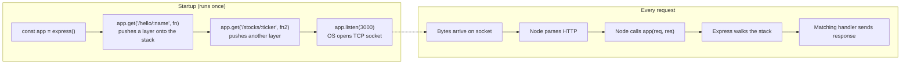
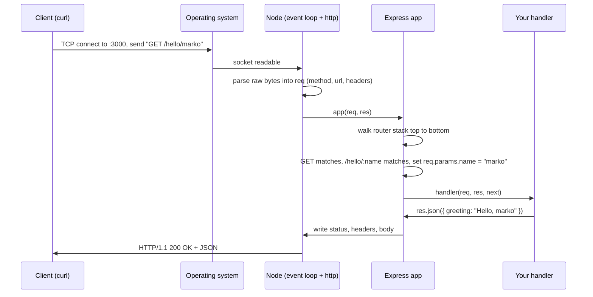
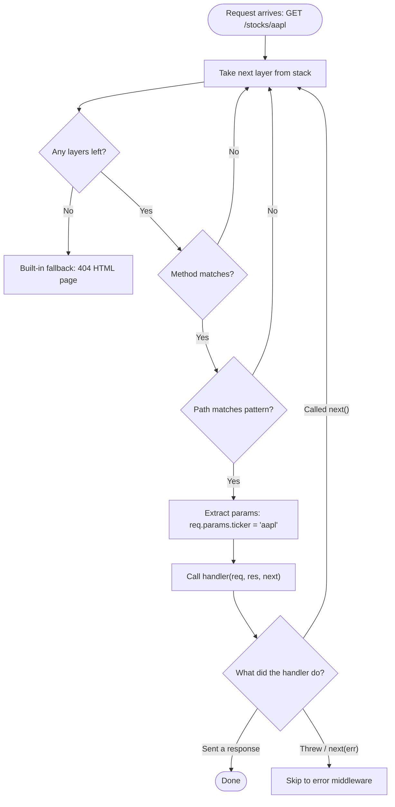

# How Express handles a request

Notes for Stockfolio. The diagrams are Mermaid: GitHub renders them automatically, and in VS Code use the "Markdown Preview Mermaid Support" extension.

---

## 1. Two phases: startup vs. every request



**Registering a handler = adding an entry to a list.** Nothing runs until a request arrives.

---

## 2. The full journey of one request



---

## 3. How Express picks a handler (the stack walk)



---

## 4. The router stack as a list

```
app.get('/', h1)              ->  [0] GET  /               h1
app.get('/hello/:name', h2)   ->  [1] GET  /hello/:name    h2
app.get('/stocks/:ticker', h3)->  [2] GET  /stocks/:ticker h3
                                  [ ] (end)  -> built-in 404

GET /stocks/aapl
  [0] GET /              path no match -> next
  [1] GET /hello/:name   path no match -> next
  [2] GET /stocks/:ticker MATCH -> h3 runs with req.params.ticker = 'aapl'
```

---

## Key takeaways

| Fact                                                      | Consequence                                                                                 |
| --------------------------------------------------------- | ------------------------------------------------------------------------------------------- |
| `app` is the single callback Node calls for every request | `app.listen(3000)` = `http.createServer(app).listen(3000)`                                  |
| Routes are stored in registration order                   | **Order matters**: `/stocks/:ticker` registered before `/stocks/top` swallows `/stocks/top` |
| A handler either responds or calls `next()`               | Forgetting both leaves the request hanging until it times out                               |
| `app.use(fn)` adds a layer matching every path            | That is all middleware is (App 3)                                                           |
| Everything runs on one thread (the event loop)            | CPU-heavy work in a handler blocks all users. Awaiting I/O (DB, HTTP) is fine               |
